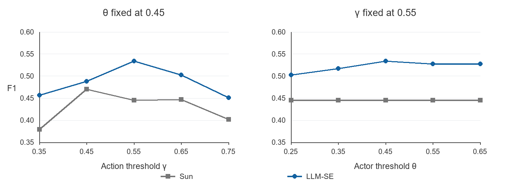

# Part 3 双参数敏感性实验

展示更新：2026-10-14。图例、表格和正文使用 Sun / LLM-SE；Sun 指 Sun et al. (2024) 方法的本地独立重建。数值来自 2026-10-10 冻结扫描，未重新推理或评分；本副本不包含 2026-10-12 局部修复实验的结果。

原始来源：[stage3_gamma_theta_sensitivity_20261010_v1.md](stage3_gamma_theta_sensitivity_20261010_v1.md)、[stage3_gamma_theta_sensitivity_20261010_v1.json](stage3_gamma_theta_sensitivity_20261010_v1.json)。

任务：S3-GAMMA-THETA-SENSITIVITY-V1；开发分析；2026-10-10。

复用原 Part 2 预测和 BPMN，固定 MPNet、检查器、参考及原表评价范围。γ 扫描时 θ=0.45；θ 扫描时 γ=0.55。9 个不同配置、18 个方法评价，基准在两条曲线中共用；新增 LLM/API/网络调用均为 0。

基准 690 个逐案例信号与原信号完整对象一致，整体/分类型计数与指标完全一致。

## 总体结果

| 扫描 | 值 | Sun P | Sun R | Sun F1 | LLM-SE P | LLM-SE R | LLM-SE F1 |
|---|---:|---:|---:|---:|---:|---:|---:|
| gamma | 0.35 | 0.3824 | 0.3768 | 0.3796 | 0.3978 | 0.5362 | 0.4568 |
| gamma | 0.45 | 0.4286 | 0.5217 | 0.4706 | 0.4141 | 0.5942 | 0.4881 |
| gamma | 0.55 | 0.3814 | 0.5362 | 0.4458 | 0.4393 | 0.6812 | 0.5341 |
| gamma | 0.65 | 0.3762 | 0.5507 | 0.4471 | 0.3934 | 0.6957 | 0.5026 |
| gamma | 0.75 | 0.3400 | 0.4928 | 0.4024 | 0.3492 | 0.6377 | 0.4513 |
| theta | 0.25 | 0.3814 | 0.5362 | 0.4458 | 0.4216 | 0.6232 | 0.5029 |
| theta | 0.35 | 0.3814 | 0.5362 | 0.4458 | 0.4286 | 0.6522 | 0.5172 |
| theta | 0.45 | 0.3814 | 0.5362 | 0.4458 | 0.4393 | 0.6812 | 0.5341 |
| theta | 0.55 | 0.3814 | 0.5362 | 0.4458 | 0.4312 | 0.6812 | 0.5281 |
| theta | 0.65 | 0.3814 | 0.5362 | 0.4458 | 0.4312 | 0.6812 | 0.5281 |

## 分类型 F1 与覆盖率

| 扫描 | 值 | 方法 | 缺失动作 F1 | 错误角色 F1 | 顺序 F1 | Macro F1 | 覆盖率 |
|---|---:|---|---:|---:|---:|---:|---:|
| gamma | 0.35 | Sun | 0.1702 | 0.4884 | 0.5000 | 0.3862 | 0.7711 |
| gamma | 0.35 | LLM-SE | 0.2500 | 0.5686 | 0.5000 | 0.4395 | 0.9154 |
| gamma | 0.45 | Sun | 0.4444 | 0.4935 | 0.5000 | 0.4793 | 0.7463 |
| gamma | 0.45 | LLM-SE | 0.3438 | 0.5800 | 0.5000 | 0.4746 | 0.9154 |
| gamma | 0.55 | Sun | 0.4554 | 0.4262 | 0.5000 | 0.4606 | 0.6667 |
| gamma | 0.55 | LLM-SE | 0.4935 | 0.5684 | 0.5000 | 0.5206 | 0.8905 |
| gamma | 0.65 | Sun | 0.4630 | 0.4138 | 0.5000 | 0.4589 | 0.6517 |
| gamma | 0.65 | LLM-SE | 0.4956 | 0.5135 | 0.5000 | 0.5030 | 0.7861 |
| gamma | 0.75 | Sun | 0.4407 | 0.2979 | 0.5000 | 0.4129 | 0.5871 |
| gamma | 0.75 | LLM-SE | 0.4783 | 0.3774 | 0.5000 | 0.4519 | 0.6816 |
| theta | 0.25 | Sun | 0.4554 | 0.4262 | 0.5000 | 0.4606 | 0.6667 |
| theta | 0.25 | LLM-SE | 0.4935 | 0.5111 | 0.5000 | 0.5015 | 0.8905 |
| theta | 0.35 | Sun | 0.4554 | 0.4262 | 0.5000 | 0.4606 | 0.6667 |
| theta | 0.35 | LLM-SE | 0.4935 | 0.5376 | 0.5000 | 0.5104 | 0.8905 |
| theta | 0.45 | Sun | 0.4554 | 0.4262 | 0.5000 | 0.4606 | 0.6667 |
| theta | 0.45 | LLM-SE | 0.4935 | 0.5684 | 0.5000 | 0.5206 | 0.8905 |
| theta | 0.55 | Sun | 0.4554 | 0.4262 | 0.5000 | 0.4606 | 0.6667 |
| theta | 0.55 | LLM-SE | 0.4935 | 0.5567 | 0.5000 | 0.5167 | 0.8905 |
| theta | 0.65 | Sun | 0.4554 | 0.4262 | 0.5000 | 0.4606 | 0.6667 |
| theta | 0.65 | LLM-SE | 0.4935 | 0.5567 | 0.5000 | 0.5167 | 0.8905 |

## 参数效应

- Sun 的 gamma 扫描：Overall F1 0.3796–0.4706；tested values 中最大值出现在 0.45。
- LLM-SE 的 gamma 扫描：Overall F1 0.4513–0.5341；tested values 中最大值出现在 0.55。
- Sun 的 theta 扫描：5 个测试点的 Overall F1 均为 0.4458，全部并列；没有唯一最佳 theta。
- LLM-SE 的 theta 扫描：Overall F1 0.5029–0.5341；tested values 中最大值出现在 0.45。

## 第二张图为何水平

θ 是执行者相似度阈值，右图固定 γ=0.55。Sun 的 80 个参与评分的角色检查中，48 个为 unknown；其余 32 个在 θ=0.25–0.65 的五个测试点上判定均未改变。所有测试点的整体 TP/FP/FN/TN 都是 37/60/32/31，因此 F1 精确相同（0.4457831325）。

原始角色信号确实有 1 个变化：`case_de1137fcd3ae`（`R5-S4-T3`）的最小执行者相似度是 0.2538，θ 从 0.25 增至 0.35 时由 satisfied 变为 violated；但该单元参考状态为 not_applicable，不参与角色评分。因此水平线不表示 θ 未生效。LLM-SE 则有 9 个原始角色状态变化，其中 7 个参与评分，故右图曲线有变化。

该结论只适用于这次扫描的数据和阈值范围，不意味着 Sun 对 θ 普遍不敏感。

## 解释边界

- 固定原表 201 个评价单元，69 正、132 负；unknown 正例计 FN，负例单独记录。
- 已使用的构造开发集，已有模型/阈值选择暴露；不是独立未见测试。
- 原顺序评价范围存在已知的端点依赖纳入问题；本实验为参数隔离而保持该范围，不据此解决范围问题或更新主表。
- 原检查器含共用角色文本规范化，使用原代码独立快照；当前生产实现和旧结果未改。
- 两条单参数扫描未检验 γ×θ 交互；不宣称全局最优、不自动选择新默认值。
- 新版清理提示词没有参与本次实验，不能把本结果移植为新版提示词性能。
